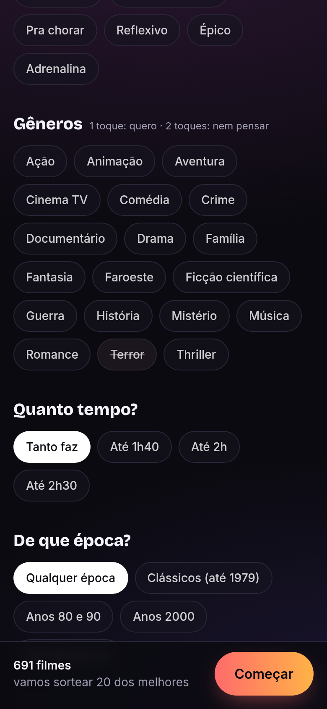
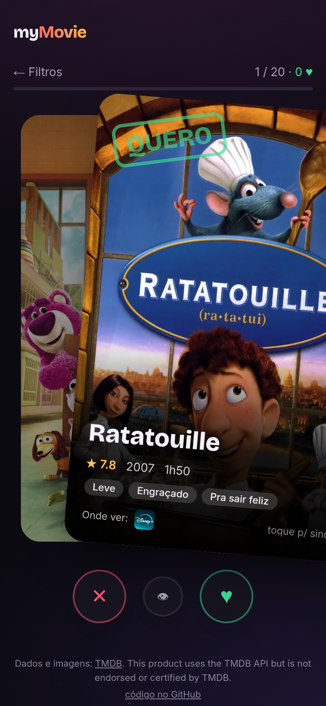
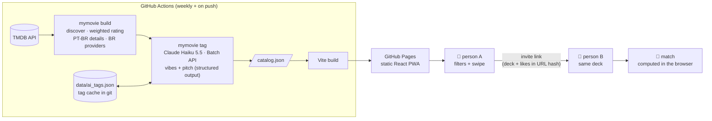

# myMovie

> Pick a well-rated movie together. Each person swipes on their own phone, and the app shows the match.

[](https://github.com/lucasnardivieira/myMovie/actions/workflows/ci.yml)
[](https://github.com/lucasnardivieira/myMovie/actions/workflows/deploy.yml)

**Live:** https://lucasnardivieira.github.io/myMovie/ (UI in Brazilian Portuguese)

<p>
  
  
  
  
</p>

<sub>Posters and data from TMDB.</sub>

## Problem
Couples spend more time scrolling streaming catalogs than watching. myMovie makes the choice short and fair:

1. **Filter by mood.** Pick a vibe (light, tense, makes-you-cry…), genres you want or refuse, a runtime limit and an era.
2. **Swipe.** You get a 20-card deck drawn from the *best-rated* movies that fit the filters.
3. **Send the invite.** The link carries the same deck. Your partner swipes it on their phone.
4. **Match.** You see the movies you both liked, best-rated first. If nothing matches, it suggests the best-rated movie either of you liked.

## Architecture


- **No backend.** Everything the app needs is a static JSON, and the couple's state travels in the invite link, so the API keys never reach the browser. See [ADR 0001](docs/adr/0001-tmdb-static-site-couple-match.md).
- **Ranking.** Raw averages favour obscure titles with a handful of votes, so each movie is scored with the [IMDb weighted rating](https://en.wikipedia.org/wiki/IMDb#Rankings):

  $$WR = \frac{v}{v+m} R + \frac{m}{v+m} C$$

  Here $R$ is the movie's average, $v$ its vote count, $C$ the mean vote across candidates and $m$ the 70th percentile of vote counts. The catalog keeps the top 2,000 movies with $WR \ge 6.5$ among movies with at least 500 votes.
- **Watch providers.** TMDB lists ad tiers and store channels as separate providers ("Netflix Standard with Ads", "HBO Max Amazon Channel"). The pipeline collapses them into one logo per service.
- **Vibes.** Every movie gets vibes derived from its genres. Claude then replaces them with a judgment of how watching it *feels*: a dark comedy isn't "light". Claude also writes a one-line pitch in PT-BR.
- **Decks.** Each deck is a seeded shuffle of the 60 best-rated movies that fit the filters, so rounds feel fresh without dropping quality.

## Tech stack
| Layer | Tools |
|---|---|
| Pipeline | Python 3.12 · uv · httpx · Pydantic · pytest · ruff |
| AI | Anthropic Claude Haiku 5.5 · Message Batches API · structured outputs (JSON schema) |
| Web | React 19 · TypeScript · Vite · Tailwind CSS v4 · framer-motion · Vitest · oxlint |
| Delivery | GitHub Actions (CI, weekly refresh) · GitHub Pages |

## Data sources
- [TMDB API](https://developer.themoviedb.org/): titles, PT-BR overviews, posters, runtime, ratings, and Brazilian watch providers from JustWatch via TMDB.
  *This product uses the TMDB API but is not endorsed or certified by TMDB.*

## How to run
Requires [uv](https://docs.astral.sh/uv/) and Node 24.

```bash
make setup
make test          # pytest + vitest
make dev           # http://localhost:5173 using the sample catalog
```

To use real data, copy `.env.example` to `.env` and fill in the tokens. Then:

```bash
make catalog       # TMDB → web/public/data/catalog.json (~10 min)
make tag           # Claude batch for movies not yet tagged (minutes to ~1 h)
make dev
```

### Deploy
1. Add the repository secrets `TMDB_API_TOKEN` and `ANTHROPIC_API_KEY` under Settings → Secrets and variables → Actions.
2. Set Settings → Pages → Source to **GitHub Actions**.
3. Push to `main` or run the *Refresh catalog & deploy* workflow. It also runs every Monday.

Without the secrets, the deploy still works and publishes the sample catalog.

## Cost & teardown
| Item | Cost |
|---|---|
| GitHub Pages + Actions (public repo) | free |
| TMDB API | free (non-commercial, with attribution) |
| Claude tagging, first run (~2,000 movies) | ≈ US$0.25 (Haiku 5.5, 50% batch discount) |
| Claude tagging, weekly runs | cents: only new movies are tagged |

Teardown: disable Pages (Settings → Pages), delete the two secrets, and revoke the keys in TMDB and the Anthropic Console. Nothing else is provisioned.

## What I learned
- Structured outputs and the Batch API make LLM enrichment a plain, cheap, idempotent pipeline step. The cache turns it into an incremental load.
- A URL hash is enough state for a two-person flow. No backend means nothing to secure, pay for or operate.
- The weighted rating from v1 carried over unchanged. Only the data source and the delivery changed.

## Roadmap
- [x] v1: genre filter + weighted rating over a Kaggle dump (CLI)
- [x] v2: TMDB pipeline, Claude vibes, couple match PWA on GitHub Pages
- [ ] Eval set for vibe tagging (label ~50 movies, measure agreement)
- [ ] Optional streaming filter (show only what we can watch tonight)
- [ ] Natural-language requests ("something like Amélie") with embeddings + a small API
