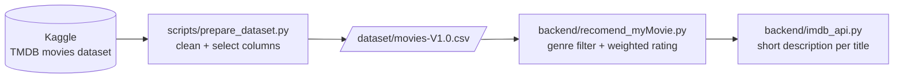

# myMovie

A movie recommender that picks titles by **genres to include / exclude** and ranks them with **IMDb's weighted rating**, over the ~1M-movie TMDB dataset. It is the first iteration of a longer-term project: the next versions move from rules to content-based and LLM-assisted recommendations.

## How it works



**Ranking.** Raw averages favour obscure titles with a handful of votes, so each movie is scored with the [IMDb weighted rating](https://en.wikipedia.org/wiki/IMDb#Rankings):

$$WR = \frac{v}{v+m} R + \frac{m}{v+m} C$$

| Symbol | Meaning |
|---|---|
| $R$ | the movie's average vote |
| $v$ | its vote count |
| $C$ | the mean vote across the dataset |
| $m$ | the 70th percentile of vote counts |

A movie needs many votes before its own average outweighs the global mean.

**Enrichment.** For each recommended title, `imdb_api.py` fetches a short description from an **unofficial**, community-run IMDb API. It can be slow or unavailable, and failures are logged and skipped.

## Setup

Requires [uv](https://docs.astral.sh/uv/).

```bash
git clone https://github.com/lucasnardivieira/myMovie.git
cd myMovie
uv sync
```

### Get the data
The dataset is not stored in git: it is about 42 MB after cleaning and much larger raw. Rebuild it from Kaggle with one of the two options below.

1. Use a Kaggle API token:
   - Create one at kaggle.com → Settings → API.
   - Copy `.env.example` to `.env` and fill in `KAGGLE_USERNAME` and `KAGGLE_KEY`.
   - Run:

     ```bash
     uv run --env-file .env python scripts/prepare_dataset.py
     ```

2. Or download [Full TMDB Movies Dataset 2024](https://www.kaggle.com/datasets/asaniczka/tmdb-movies-dataset-2023-930k-movies) manually and point the script at the CSV:

   ```bash
   uv run python scripts/prepare_dataset.py --source ~/Downloads/TMDB_movie_dataset_v11.csv
   ```

The script reproduces the cleaning explored in [`dataset/exploring_dataset.ipynb`](dataset/exploring_dataset.ipynb):
- keep title, votes, release date, IMDb id, genres and keywords
- drop rows without a title, genre or IMDb id
- normalize titles
- split genres and keywords into lists

## Run

```bash
uv run python backend/recomend_myMovie.py
```

The genres to include and exclude are set at the bottom of the script (default: Action + Science Fiction, excluding Horror, Romance and Fantasy).

## Roadmap
- [ ] Recommender as a function/CLI with parameters instead of module-level code
- [ ] Clean genre values (strip spaces) and fix the adult-content filter from the notebook
- [ ] Tests for the cleaning and ranking logic
- [ ] Content-based similarity on keywords/overview (TF-IDF → embeddings)
- [ ] Natural-language requests ("a light sci-fi for tonight") with an LLM + retrieval
